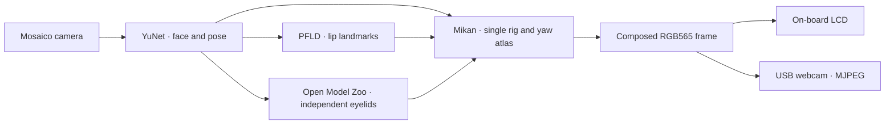

# Mikan · a cat avatar camera for Mosaico

[简体中文](README.zh-CN.md)

Mikan is a ginger cat that turns with your head, opens its mouth when you do, and can close either eye independently. Camera capture, face tracking, expression inference, compositing, and display all run on the ESP32-S31 Mosaico. Live use starts without personal calibration.

  
   <em>Live USB capture from the board in centered mode.</em>

## Two views, one character

The app starts with Mikan centered on a black background. A short press of the **AI** button switches to a camera overlay that follows the face. Yaw, pitch, mouth opening, and independent eyelids work in both views. The same composed frame feeds the LCD and the optional USB webcam. Centered mode uses a 320 × 320 canvas drawn 1:1 on the LCD, with a 320 × 240 MJPEG presentation for UVC.

## How the cat turns

One six-bone rig drives the head, jaw, eyelids, muzzle, and nose. Artwork is projected offline onto an approximate depth surface. The v59 atlas samples yaw every 2° and stores only one side, with the opposite side mirrored around a shared frontal view. Each angle has one outer contour, and the jaw's position and lip line follow the current view. The board decodes only the current head and eyelids.

  
   <em>Same 93-frame scripted turn on the board. Left: v58. Right: v59. Enlarged UVC crops, paced for comparison.</em>

[View keyframes](media/yaw-ab-keyframes.png) · [View the earlier ear-to-cheek contour fix](media/ear-rim-ab.png)

## Measured on Mosaico

| Same input, UVC on | v58 FPS | v59 FPS | v59 minimum Python free heap | v59 minimum largest IDF free block |
| --- | ---: | ---: | ---: | ---: |
| Centered | 3.79 | 3.13 | 144,400 B | 56,320 B |
| Camera overlay | 3.63 | 2.97 | 144,384 B | 31,744 B |

For the scripted turn, the P95 mean RGB difference between adjacent avatar crops fell from **26.65 to 7.49**. Finer angle sampling costs texture decoding time. These are application frame rates with an active UVC client. The turn replay checks rendering with known landmarks. It does not measure pose accuracy during fast human motion. [Measurement details](docs/measurements.md)

## Run it

- **Model-free pose replay.** Run the board-rendered animation over LCD and USB using three bundled files and scripted landmarks. [Quick start](docs/run-on-mosaico.md#play-the-model-free-demo)
- **Live expression tracking.** The runtime includes the YuNet and eye models. Supply a compatible, authorized PFLD lip model separately. [Live setup](docs/run-on-mosaico.md#run-the-live-camera) · [Third-party notices](THIRD_PARTY_NOTICES.md)

Powered by [ESP-VISION](https://github.com/espressif/esp-vision). Mikan is a standalone application built on the stock 2026.11.14 firmware.
