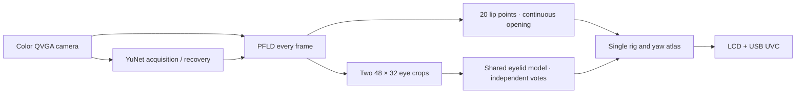

# Mikan · a cat avatar camera for Mosaico

[简体中文](README.zh-CN.md)

Mikan turns your head motion, mouth opening and independent eyelids into a ginger cat. Capture, inference, single-rig rendering, LCD and USB UVC output run entirely on **ESP32-S31 Mosaico**, with **ESP-VISION 2026.11.14** and no personal calibration.

The current public source snapshot is **v78**, tested on 2026-11-23. It adds a Mikan startup animation and bottom guidance while retaining the v77 expression pipeline. **Compatible PFLD and custom eyelid weights must be supplied separately; this is not a complete ready-to-run live bundle.** [Model contracts](runtime/v78/models/README.md)

| Startup brand | Runtime guidance |
| :---: | :---: |
|  |  |

Actual 480×480 LCD captures, not design mockups. The guidance page is scaled and its text is visibly soft; improving it remains open. Normal tracked rendering retains the native 320-square cat canvas.

[Setup](docs/run-v78.md) · [Implementation and evidence](docs/v78-startup-and-guidance.md) · [Project handoff](HANDOFF.md) · [Documentation](docs/README.md)

## Controls and behavior

| AI button | Action |
| --- | --- |
| Short press | Centered cat ↔ face-following camera overlay |
| Hold at least 650ms | Toggle the landmark page |
| Short press in the landmark page | Return to the previous mode |

Mouth aperture is continuous and prioritized for the current frame. Each eye uses its own two-of-three valid-observation vote. Pitch and eyebrow effects are disabled. The startup logo uses preset eye/mouth patches and preencoded UVC JPEGs, without additional inference models or live 3D rendering. It is an application startup screen; power-cycle autostart is not configured by v78.

Guidance appears only after sustained tracking loss, using current evidence for generic positioning or frame-boundary rejection. The app does not claim to distinguish “nobody present”, “half face” or “too close” from a generic detection failure.

Ordinary rendering submits the current mouth before scheduled eye inference. The cat uses depth-projected textures and a yaw atlas for a 2.5D appearance, rather than a complete real-time 3D mesh. [Inherited expression architecture](docs/current-v77.md)

## Measured scope

The v77 baseline ran 260 public-input observations in one sequence. Final v78 verification used two bounded runs: **114 expression/landmark observations + 146 recovery/guidance observations**, each after a hard reset with native UVC enabled.

| Controlled replay metric | v77 | v78 |
| --- | ---: | ---: |
| Centered processing throughput | 6.308FPS | 6.300FPS |
| Overlay processing throughput | 3.891FPS | 3.954FPS |
| Minimum Python free | 172,896B | 417,056B |
| Minimum IDF free | 139,771B | 238,979B |
| Minimum largest IDF block | 31,744B | 100,352B |
| UVC submissions | 258/260 | 260/260 |

All 114 stable outputs match v77, as do the measurements of all 132 observations tracking in both versions. Recovery includes 13 state differences under the wall-clock detector cooldown. A previous long candidate run was host-terminated at frame205 and is excluded from completed results.

Throughput excludes fixture decoding and deliberate dwell; repeated static centered inputs benefit from caching. These are not live-camera FPS, general accuracy or optical-latency claims. Python and IDF allocator figures must not be added. [Full protocol and limitations](docs/v78-startup-and-guidance.md) · [Numerical evidence](evidence/v78-ui/README.md)

## Run and continue

- [v78 setup and exact 15-file manifest](docs/run-v78.md): five new UI/application files live under an independent device directory, with existing shared modules and artwork reused. YuNet is included; the two external weight contracts remain unchanged.
- [Known challenges and next work](HANDOFF.md): notification clarity, large-mouth underestimation, pressed-lip false openings, glasses and near-range loss remain open. The UI update does not resolve model accuracy.
- [Mouth same-input investigation](docs/mouth-validation-round1.md): 117 board inferences and 19 exact RGB565/FP32 comparisons; one public subject, not a multi-person benchmark.
- [Historical rendering-only demo](docs/run-on-mosaico.md#play-the-model-free-demo): preserved v59 code uses scripted landmarks to demonstrate rendering without inference models. It does not recognize camera expressions.

## How the cat turns

One six-bone rig drives the head, jaw, eyelids, muzzle, and nose. Artwork is projected offline onto an approximate depth surface. The v59 atlas samples yaw every 2° and stores only one side, with the opposite side mirrored around a shared frontal view. Each angle has one outer contour, and the jaw's position and lip line follow the current view. The board decodes only the current head and eyelids.

  
   <em>Same 93-frame scripted turn on the board. Left: v58. Right: v59. Enlarged UVC crops, paced for comparison.</em>

[View keyframes](media/yaw-ab-keyframes.png) · [View the earlier ear-to-cheek contour fix](media/ear-rim-ab.png)

## Provenance and release history

Runtime Python files are copied byte-for-byte from the verified local checkpoint `e7feab2`; the public branch has its own publication history. New v78 files are under `runtime/v78`, with reviewed branding sources and cat-only screenshots. Original v77/v59 source and demonstrations remain available. Root `app.py` and `runtime-manifest.json` are historical v59 entries, not the current v78 pipeline.

Personal captures, public-dataset crops, raw device logs and experimental caches are omitted. PFLD and custom spatial-eyelid weights remain external. [Third-party notices](THIRD_PARTY_NOTICES.md)

Powered by [ESP-VISION](https://github.com/espressif/esp-vision).
