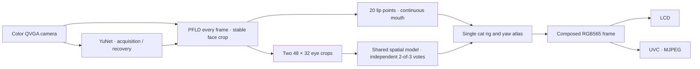
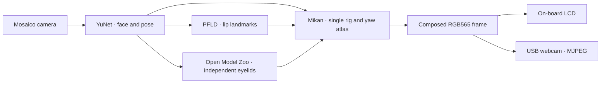

# Mikan · a cat avatar camera for Mosaico

[简体中文](README.zh-CN.md)

Mikan follows your head turn, mouth opening and independent eyelids as a ginger cat. Capture, tracking, expression inference, composition and display run entirely on ESP32-S31 Mosaico with stock ESP-VISION 2026.11.14. Live use requires no personal calibration.

 <em>Current v77 board display, captured after restoring the application.</em>

## Current development: v77

The app starts with a centered cat. Short-press **AI** for the face-following camera overlay; hold it for the landmark page. Both modes share the single rig and mouth/eye controls, and feed the LCD and optional UVC webcam. Pitch and eyebrow effects are disabled in this version.

The runtime prioritizes current-frame mouth submission and normally computes eye updates afterwards. One unreliable eye can expire independently while a strongly supported face and mouth keep tracking. [Current architecture, measurements and limitations](docs/current-v77.md)

The first new mouth diagnosis ran **117 board inferences** on 13 public images and compared **19 exact native RGB565 inputs** with FP32. A wide opening measured 21.3 source pixels manually, 11.9 on the board and 11.8 in FP32 despite the lower lip remaining in frame. The batch contains one public subject and is not a multi-person accuracy benchmark. Mouth-point bias, glasses errors and near-view loss remain open. [Report](docs/mouth-validation-round1.md) · [Next experiments](docs/validation-next.md)

## Run it

- **Current v77 live source:** [setup and exact manifest](docs/run-v77.md). YuNet is bundled; compatible, authorized PFLD and custom eyelid weights must be supplied separately. This is a source snapshot, not a complete ready-to-run live package. [Model contracts](runtime/v77/models/README.md)
- **Rendering demo:** [scripted pose replay](docs/run-on-mosaico.md#play-the-model-free-demo), using the preserved v59 renderer. It demonstrates board rendering without inference models; it does not track camera expressions.
- **Historical v59 live implementation:** root-level `app.py` and `runtime-manifest.json`. [Legacy setup](docs/run-on-mosaico.md#run-the-live-camera) · [Legacy performance](docs/measurements.md)

## How the cat turns

One six-bone rig drives the head, jaw, eyelids, muzzle, and nose. Artwork is projected offline onto an approximate depth surface. The v59 atlas samples yaw every 2° and stores only one side, with the opposite side mirrored around a shared frontal view. Each angle has one outer contour, and the jaw's position and lip line follow the current view. The board decodes only the current head and eyelids.

  
   <em>Same 93-frame scripted turn on the board. Left: v58. Right: v59. Enlarged UVC crops, paced for comparison.</em>

[View keyframes](media/yaw-ab-keyframes.png) · [View the earlier ear-to-cheek contour fix](media/ear-rim-ab.png)

## Measurements and provenance

The latest complete paired performance run before v77 measured v76 at 6.33 FPS centered and 3.85 FPS overlay with UVC enabled. Centered static replay benefits from composition reuse; timings exclude fixture unpacking and camera acquisition. These are not a new v77 live-camera benchmark. [Context and memory results](docs/current-v77.md#measurements-and-limits)

The public branch preserves its separate publication history and includes selected source, character artwork and numerical evidence. Personal captures, public-dataset image crops and experimental caches are omitted. [Third-party notices](THIRD_PARTY_NOTICES.md)

Powered by [ESP-VISION](https://github.com/espressif/esp-vision).
