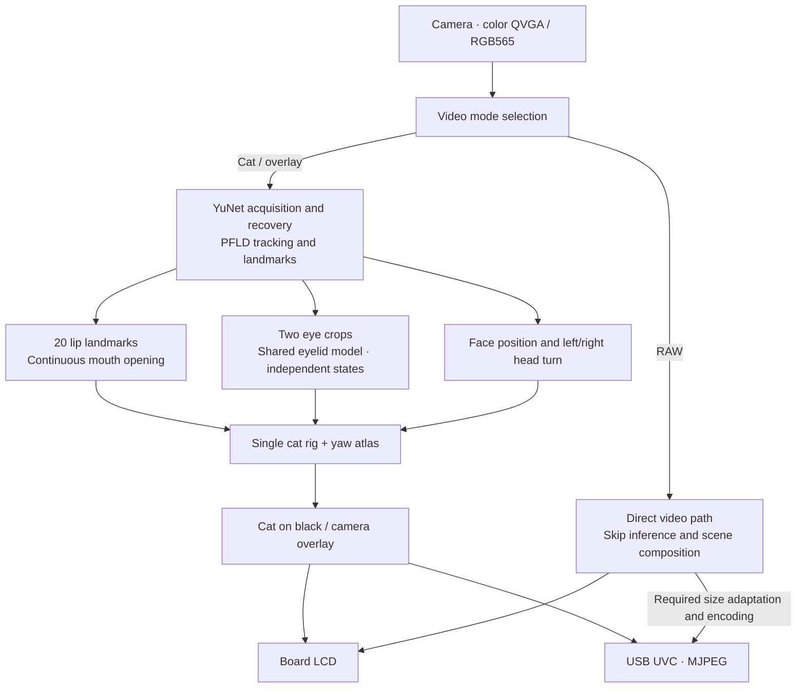

# Mikan · a private USB cat camera

[简体中文](README.zh-CN.md)

**Let a cat take your place on camera.** Mikan is a USB camera application for ESP32-S31 Mosaico. A ginger cat follows your mouth, eyelids and left/right head turns. One button switches between the private cat view, a cat over the camera background, and the original camera image.

Capture, expression inference and rendering run on the board. The computer receives USB UVC video without running face tracking or avatar software. No personal calibration is required.

  

<em>Actual Mosaico startup display, captured for v78. The current application reuses the same brand artwork.</em>

[Get started](docs/run-v80.md) · [Architecture](#architecture) · [Documentation](#documentation) · [Project status](#project-status)

## Product features

| Feature | What it does |
| --- | --- |
| Private default view | The application starts with a cat on black instead of the person and room |
| Mouth and eyelids | Continuous mouth opening and independent left/right eye states drive the character |
| Head motion | The cat turns left and right; in overlay mode it follows face position and scale |
| Three video modes | Cat, camera overlay and RAW, selected with the AI button |
| Display and USB video | The board LCD shows the current view while UVC supplies video to the computer |
| Framing guidance | Sustained tracking loss shows positioning guidance; unreliable overlay tracking falls back to the private cat |
| Local processing | The application performs inference and rendering on-device without adding recordings or network transmission |
| Animated startup | Preset blinks and mouth poses introduce Mikan before live expression control |

### Video modes

| Mode | Picture and behavior | When to use it |
| --- | --- | --- |
| **Cat**, default | Ginger cat on black, following mouth, eyelids and head turns; no person or room in the output | Express yourself through the character |
| **Overlay** | Cat head follows the face over the camera background, with a LIVE label; tracking loss temporarily returns to cat | Keep the surroundings in view with a cat avatar |
| **RAW** | Camera image without cat, labels or framing guidance; expression inference is skipped | Use the camera directly or check its framing |

Cat mode still captures images locally for inference; it does not switch off the sensor. Overlay keeps the background visible and cannot guarantee complete face coverage. Live mode is not persisted. An observed host USB video stream transition returns the application to cat.

### Controls

| AI button | Action |
| --- | --- |
| Short press | Cat → overlay → RAW → cat |
| Hold at least 650 ms, then release | Return to cat from any mode |

Ordinary button use does not enter the landmark view. Diagnostic views require an explicit developer entry.

## Architecture

One board application handles capture, inference, character animation and output. Cat and overlay share the expression pipeline. RAW branches immediately after capture.

### Tracking and expressions

| Stage | Implementation |
| --- | --- |
| Face acquisition | YuNet locates a face on entry, tracking loss or scale confirmation; steady tracking avoids full-image detection every frame |
| Landmark tracking | PFLD uses a 112×112 face input and returns 36 points plus presence: 20 lip points and eight points per eye; it also updates the face crop |
| Mouth opening | Inner-lip gaps normalized by mouth width drive continuous jaw and mouth motion, with current-mouth submission prioritized |
| Eyelid states | Two 48×32 crops from the original frame share one spatial eyelid model for lid edges and visibility; each eye maps its current result directly, without bilateral rules or historical votes |
| Position and pose | Face landmarks drive left/right turns and overlay placement; pitch and eyebrow effects are currently disabled |

Eye patches are captured before composition. Ordinary eye inference runs after LCD/UVC submission and supplies a subsequent composition. Mouth submission therefore does not wait for that eye inference, while mouth and eyes can update at different times.

### Character and output

A single six-bone rig combines offline depth projection and a yaw atlas to create the cat's 2.5D turns. The board decodes the textures needed for the current view rather than running a complete real-time 3D mesh.

Cat mode draws the character on black. Overlay draws the same character over the camera image. LCD and UVC share the mode selection and character state, with separate size adaptation. RAW bypasses model inference, rig updates and scene composition, retaining LCD transfer and the necessary USB size conversion and encoding.

The reference configuration has a 480×480 LCD and 320×240 MJPEG UVC output, with color QVGA camera input. RAW preserves aspect ratio with black margins when the camera and output dimensions differ.

## Get started

The reference hardware is **ESP32-S31 Mosaico** running official **ESP-VISION 2026.11.14**. The computer is a UVC viewer; development and deployment use the installed ESP-VISION plugin and its bundled CLI.

1. Read the [deployment guide](docs/run-v80.md) and confirm board identity, firmware and device access.
2. Prepare the source, artwork and models listed in the [runtime manifest](runtime/v80/runtime-manifest.json), checking byte counts and SHA-256 hashes.
3. Upload files to their explicit device paths. Start the independent application entry and check the LCD and USB view before handling the startup entry as described in the guide.

YuNet is included. Live recognition also requires compatible, authorized PFLD and spatial-eyelid weights supplied separately. Their filenames, interfaces and distribution scope are described in the [model contracts](runtime/v80/models/README.md).

Current source lives under `runtime/v80/`, starting with [start_v80.py](runtime/v80/start_v80.py). Root `app.py` is a historical demo. Without recognition weights, the [model-free rendering replay](docs/run-on-mosaico.md#play-the-model-free-demo) demonstrates the character using preset landmarks; it does not recognize camera expressions.

## Documentation

| What you need | Where to go |
| --- | --- |
| Install, start and roll back | [v80 setup](docs/run-v80.md) · [Exact runtime manifest](runtime/v80/runtime-manifest.json) |
| Understand the current application | [Eye mapping and RAW path](docs/v80-direct-and-raw.md) · [Main application](runtime/v80/pfld_app.py) · [Tracking and measurements](runtime/v80/pfld_tracking.py) |
| Character rendering and assets | [Cat rig](runtime/v80/kitten_rig.py) · [Brand artwork](assets/brand/README.md) |
| Model interfaces and provenance | [Model contracts](runtime/v80/models/README.md) · [Third-party notices](THIRD_PARTY_NOTICES.md) |
| Startup and framing UI | [UI design](docs/ui-ux-startup-guidance.md) · [Implementation and verification](docs/v78-startup-and-guidance.md) |
| Results and known failures | [v80 evidence index](evidence/v80-direct/README.md) · [Startup stability record](evidence/v80-direct/startup-stability.json) |
| Expression research | [Same-input mouth analysis](docs/mouth-validation-round1.md) · [Near-range and resolution investigation](docs/v77-near-range-resolution.md) |
| Continue development | [Project handoff](HANDOFF.md) · [Validation plan](docs/validation-next.md) |
| Other versions and background | [Full documentation index](docs/README.md) |

## Project status

The current source version is **v80**, with three video modes, direct independent eye mapping and a separate RAW path. Startup allocation and USB disconnect problems remain unresolved. Long-duration operation, complete physical power-cycle startup, physical buttons and natural joint eye/mouth behavior have not all been accepted. Wide-mouth, glasses/light-closure and near-range recovery limitations also remain.

The [implementation report](docs/v80-direct-and-raw.md) and [evidence index](evidence/v80-direct/README.md) retain test conditions, successful checks and failures. Controlled replay timing is not presented as live-camera FPS.
