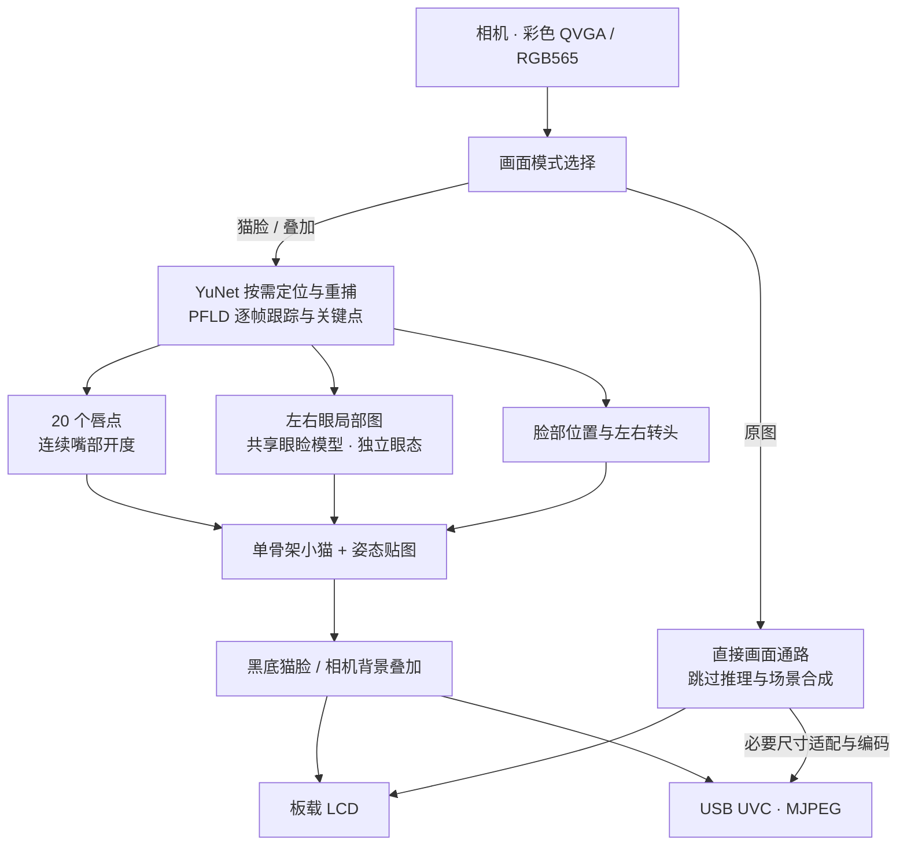

# Mikan · 隐私 USB 猫脸摄像头

[English](README.md)

**让小猫替你出镜。** Mikan 是运行在 ESP32-S31 Mosaico 上的 USB 摄像头应用：用一只橘猫表达你的嘴型、眨眼和左右转头，也可以随时切换到真人背景叠加或原图。

相机采集、表情识别和角色绘制全部在板上完成。电脑通过 USB UVC 接收画面，无需在电脑端运行识别或虚拟形象软件，也无需个人校准。

  

<em>Mosaico 实机启动页。图来自 v78，当前版本沿用相同品牌素材。</em>

[部署与使用](docs/run-v80.md) · [系统架构](#系统架构) · [文档导航](#文档导航) · [项目状态](#项目状态)

## 产品功能

| 功能 | 使用体验 |
| --- | --- |
| 默认猫脸 | 应用启动进入黑底小猫画面，用角色替代真人和房间背景 |
| 嘴型与眨眼 | 嘴巴随开口连续变化，左右眼分别映射当前识别结果 |
| 头部跟随 | 小猫随左右转头变化；叠加模式下跟随脸部位置和尺度 |
| 三种画面 | 猫脸、相机叠加、原图，通过同一个 AI 按键切换 |
| 屏幕与 USB 输出 | 板载 LCD 显示当前画面，同时向电脑提供 UVC 摄像头画面 |
| 取景引导 | 跟踪持续失效时给出入镜提示；叠加模式在失跟期间回到安全猫脸 |
| 本地运行 | 推理和绘制在设备完成，应用不新增录像存储或网络传输 |
| 品牌启动 | Mikan 启动画面包含预制眨眼和张嘴动作，进入应用后由识别结果驱动角色 |

### 画面模式

| 模式 | 画面与行为 | 适合的使用方式 |
| --- | --- | --- |
| **猫脸**，默认 | 黑底橘猫，跟随嘴型、眼态及左右转头，不输出真人和背景画面 | 希望用角色表达自己 |
| **叠加** | 保留相机背景，将猫头绘制到跟踪到的人脸位置，带 LIVE 标识；失跟时临时回到猫脸 | 希望保留环境，又使用猫头形象 |
| **原图** | 直接显示相机画面，不绘制猫头、标签或取景提示，不运行表情推理 | 需要正常取景或查看摄像头画面 |

猫脸模式仍在板内采集图像用于识别；它改变输出画面，不关闭传感器。叠加模式保留背景，不能保证始终完整遮住真人。应用不记忆上次实景模式，观察到主机 USB 视频开关变化时会回到猫脸。

### 按键操作

| AI 按键 | 操作结果 |
| --- | --- |
| 短按 | 猫脸 → 叠加 → 原图 → 猫脸 |
| 按住至少 650 ms 后松开 | 从任意模式返回猫脸 |

普通按键不进入开发关键点页。调试视图通过显式开发入口启用。

## 系统架构

Mikan 把相机、识别、角色和输出放在同一个板端应用中。猫脸与叠加共用识别链路；原图在取帧后进入独立输出通路。

### 识别与表情

| 环节 | 实现方式 |
| --- | --- |
| 人脸定位 | YuNet 在首次入镜、丢跟重捕或需要确认尺度时定位人脸；稳定跟踪时避免每帧重复全图检测 |
| 关键点跟踪 | PFLD 使用 112×112 脸部输入，输出 36 个点及存在分数：20 个唇点、每眼 8 点；同时维护脸部裁框 |
| 嘴部开度 | 从内唇间隙和嘴宽计算连续开度，驱动嘴角与下颌，优先提交当前嘴型 |
| 眼部状态 | 从原图裁出左右眼各 48×32 局部图，复用同一个空间眼睑模型测量上下睑缘和可见性；每眼直接映射当前结果，无双眼耦合或历史投票 |
| 头部与位置 | 利用脸部关键点驱动左右转头及叠加位置；当前关闭俯仰和眉毛效果 |

眼部局部图在合成前取出，常规眼部推理安排在 LCD/UVC 提交之后，结果供后续合成使用。这样嘴型提交不必等待本轮眼部推理，但眼、嘴并非同一时刻更新。

### 角色与画面输出

小猫采用一套六骨骼结构，结合离线深度投影与偏航贴图，形成随左右转头变化的 2.5D 外观。设备只解码当前需要的贴图，不在板上运行完整实时三维网格。

猫脸模式合成黑底角色；叠加模式把同一角色绘制到相机背景上。LCD 与 UVC 使用相同模式选择和角色状态，分别适配显示尺寸。原图跳过模型推理、骨架更新和场景合成，只保留 LCD 传输、USB 必要尺寸适配及编码。

当前参考配置为 480×480 LCD 和 320×240 MJPEG UVC；相机输入为彩色 QVGA。板载屏幕、相机方向和 USB 画幅不同，原图适配会保持比例并留黑边。

## 开始使用

参考硬件为 **ESP32-S31 Mosaico**，固件为官方 **ESP-VISION 2026.11.14**。电脑作为 UVC 查看端，开发与部署使用安装的 ESP-VISION 插件及其 CLI。

1. 阅读[部署说明](docs/run-v80.md)，核对板型、固件和设备使用权。
2. 按[运行清单](runtime/v80/runtime-manifest.json)准备源码、角色素材与模型，验证文件大小和 SHA-256。
3. 上传到清单列出的设备路径，先显式启动独立入口，检查 LCD 和 USB 画面，再按部署说明处理自启入口。

公开包附带 YuNet；实时识别还需要另行供应兼容且有授权的 PFLD 与空间眼睑权重。外供模型的接口、文件名和供应边界见[模型说明](runtime/v80/models/README.md)。

当前应用入口为 [start_v80.py](runtime/v80/start_v80.py)。公开仓库的 `runtime/v80/` 保存当前源码，根目录旧 `app.py` 属于历史演示。没有识别模型时，可参考[无模型渲染回放](docs/run-on-mosaico.md#play-the-model-free-demo)了解角色效果；该回放使用预设关键点，不识别人脸表情。

## 文档导航

| 想了解的内容 | 文档入口 |
| --- | --- |
| 安装、启动、依赖与回滚 | [v80 部署说明](docs/run-v80.md) · [精确运行清单](runtime/v80/runtime-manifest.json) |
| 当前应用如何实现 | [眼态与原图通路](docs/v80-direct-and-raw.md) · [主应用](runtime/v80/pfld_app.py) · [跟踪与测量](runtime/v80/pfld_tracking.py) |
| 角色绘制与素材 | [角色骨架](runtime/v80/kitten_rig.py) · [品牌素材](assets/brand/README.md) |
| 模型接口和来源 | [模型供应说明](runtime/v80/models/README.md) · [第三方说明](THIRD_PARTY_NOTICES.md) |
| 启动画面与取景引导 | [启动与引导设计](docs/ui-ux-startup-guidance.md) · [实现与验证](docs/v78-startup-and-guidance.md) |
| 当前测试结果与已知问题 | [v80 证据索引](evidence/v80-direct/README.md) · [启动稳定性记录](evidence/v80-direct/startup-stability.json) |
| 嘴部与近景识别研究 | [嘴部同输入分析](docs/mouth-validation-round1.md) · [近景与分辨率归因](docs/v77-near-range-resolution.md) |
| 接手开发与后续工作 | [项目交接](HANDOFF.md) · [验证计划](docs/validation-next.md) |
| 查找其他版本与历史材料 | [完整文档索引](docs/README.md) |

## 项目状态

当前源码版本为 **v80**，已实现三模式、独立眼态直接映射和原图快速通路。启动内存分配与 USB 断连仍有未解决问题；长时间运行、完整断电自启、实体按键及自然嘴眼联合动作尚未完成全部验收。大张嘴、戴镜/轻闭眼和近景恢复也仍有识别限制。

具体测试条件、成功记录与失败范围保存在[实现报告](docs/v80-direct-and-raw.md)和[证据目录](evidence/v80-direct/README.md)，不将受控回放速度当作真人帧率。
