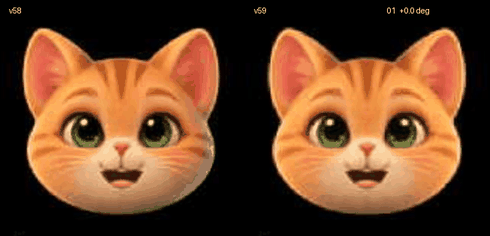

# Mikan · Mosaico 单机小猫相机

[English](README.md)

[项目交接 · 当前进展、剩余挑战与下一步](HANDOFF.md)

采集、跟踪、推理、单骨架小猫合成与显示全部在 ESP32-S31 Mosaico 上运行，使用官方 ESP-VISION 2026.11.14，无需个人校准。

## 当前版本 v77

默认居中显示猫头，短按 **AI** 切换相机叠加，长按进入关键点页。两种模式保留嘴和左右眼跟随，LCD 与 UVC 共用合成结果。本版关闭抬头低头和眉毛效果。

YuNet 在首次入镜或需要重捕时确定框位，稳定时每帧 PFLD 跟踪，20 个唇点驱动连续开度。左右眼裁成 48×32 小图，复用一个空间眼睑模型，各自最近三次有效观测中任意两次一致才更新。当前嘴型优先提交，眼部推理通常随后进行。单侧眼图暂时失效时，有充分支持的嘴和另一侧可继续跟随。[当前架构与限制](docs/current-v77.md)

最新嘴部排查完成 13 张公开图、117 次板上推理、19 份实际 RGB565 输入的浮点对照。大张嘴的人工间隙 21.3 像素，板上预测 11.9，浮点预测 11.8，下唇仍在输入内。模型唇点偏差尚未解决；换分母或统一移框没有形成可上线的修复。这批来自一个公开人物，不能代表多人准确率。[完整报告](docs/mouth-validation-round1.md) · [后续验证](docs/validation-next.md)

## 运行与复现范围

- [v77 源码及上板方法](docs/run-v77.md)保留实测版本的源码和清单。YuNet 已附带，PFLD 和自研眼睑模型权重需另行提供兼容且具备授权的文件；公开版不是开箱即用的完整实时模型包。[模型接口](runtime/v77/models/README.md)
- [无推理模型的板上渲染演示](docs/run-on-mosaico.md#play-the-model-free-demo)沿用 v59，通过预设关键点播放转头和口眼动作，不识别相机中的人脸。
- 根目录 `app.py` 和 `runtime-manifest.json` 保留历史 v59 实现。[历史测量](docs/measurements.md)

最近一次完整配对性能测试是 v76 的受控回放，居中 6.33 FPS、叠加 3.85 FPS，UVC 开启。居中重复静态画面受益于合成复用；计时不含相机采样，不视为新一轮 v77 真人性能。叠加 Python 最低空闲 277,376 B，IDF 最低总空闲／最大连续块 139,767／31,744 B。[数值与范围](docs/current-v77.md#measurements-and-limits)

近距离仍可能被跟踪安全余量和重捕门槛拦住，戴镜眼态、大张低估和抿嘴误开仍待修复。本次公开更新包含筛选后的源码、美术和数值汇总，未包含人脸原图、个人录像或实验缓存。

## 历史渲染优化

单骨架与离线深度投影贴图沿用此前方案。更密的角度采样改善转头换档，历史 93 帧脚本回放中的相邻画面差值 P95 从 26.65 降到 7.49。[静帧](media/yaw-ab-keyframes.png) · [耳根修复](media/ear-rim-ab.png)

Powered by [ESP-VISION](https://github.com/espressif/esp-vision)。[第三方说明](THIRD_PARTY_NOTICES.md)
