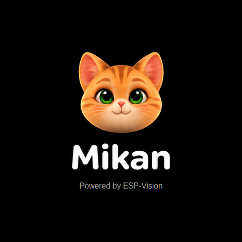

# Mikan · Mosaico 单机小猫拟我相机

**Powered by [ESP-VISION](https://github.com/espressif/esp-vision)** · [English](README.md)

让小猫跟随你的嘴型、左右眼开闭和转头。相机、模型推理、单骨架贴图、LCD与USB UVC输出全部在 **ESP32-S31 Mosaico** 上运行；固件为 **ESP-VISION 2026.11.14**，无需个人校准。

当前公开源代码快照为 **v78**，实机证据日期为2026-11-23。新增品牌启动动画与底部取景引导，表情算法沿用v77。**实时运行仍需自行供应兼容且有授权的PFLD和空间眼睑权重，公开包不是完整开箱即用的模型包。** [模型接口与供应范围](runtime/v78/models/README.md)

| Mikan启动页 | 运行中的取景提示 |
| :---: | :---: |
|  |  |

以上为原生480×480 LCD截图。失跟引导页存在缩放，通知文字发虚仍待改进；正常跟随保留原320画布的像素比例。

[上板与运行](docs/run-v78.md) · [实现与验证](docs/v78-startup-and-guidance.md) · [交接与待办](HANDOFF.md) · [文档索引](docs/README.md)

## 功能与操作

- 默认居中猫头，短按AI键切换相机叠加跟随。两种模式共用同一套嘴眼测量与骨架。
- 嘴部连续开度优先随当前帧提交；左右眼独立，以最近三个有效观测中的任意两次一致确认。
- 按住AI键至少650ms切换关键点页；关键点页短按退出。
- 品牌页使用紧凑底图、预制眨眼／张嘴贴片与预编码UVC画面，不增加推理模型。
- 运行通知只依据当前观测提示“请正对镜头”或“请调整位置”，不将未检出直接解释为无人、半脸或太近。

眉毛与抬头低头效果关闭。启动动画属于Mikan应用启动阶段；v78保留设备原main.py，没有配置断电自动进入应用。

## 当前架构

彩色QVGA → YuNet按需捕获／重捕 → PFLD逐帧跟踪 → 20唇点的连续开度 + 原图裁双眼并复用局部眼睑模型 → 单骨架与角度贴图 → LCD/UVC。

普通模式先提交当前嘴型，再执行调度的眼部推理。猫头以深度投影和偏航贴图实现2.5D体积效果，并非完整实时三维网格。[算法与调度](docs/current-v77.md)

## 实测范围

旧版一段260帧；最终v78分为114帧表情／关键点和146帧保护／引导，每段前硬复位，UVC开启。

| 受控回放指标 | v77 | v78 |
| --- | ---: | ---: |
| 居中处理帧率 | 6.308FPS | 6.300FPS |
| 叠加处理帧率 | 3.891FPS | 3.954FPS |
| 最低Python空闲 | 172,896B | 417,056B |
| 最低IDF空闲 | 139,771B | 238,979B |
| 最大连续IDF块的最低值 | 31,744B | 100,352B |
| UVC提交成功 | 258/260 | 260/260 |

114帧表情／关键点输出与v77一致；双方均在跟踪的132帧测量也一致。恢复阶段有13帧状态差异，受真实时间检测冷却影响，不能宣称整段逐帧一致。一次长回归在205帧被宿主终止，不计为连续260帧通过。

帧率扣除了夹具解码和人为等待；静态居中图受益于缓存。这不是新的真人帧率、准确率或光学延迟保证。Python与IDF统计不能相加。[完整口径](docs/v78-startup-and-guidance.md) · [数值和截图](evidence/v78-ui/README.md)

## 下一步与历史演示

通知清晰度、大张嘴低估、抿嘴误开、眼镜和近景失效仍待解决；UI更新没有消除这些模型限制。[项目交接](HANDOFF.md) · [嘴部同输入验证](docs/mouth-validation-round1.md) · [算法验证规划](docs/validation-next.md)

保留[历史转头对比](media/yaw-ab.gif)和[轮廓修复对比](media/ear-rim-ab.png)。[不依赖推理模型的历史回放](docs/run-on-mosaico.md#play-the-model-free-demo)使用预设关键点，仅验证板上绘制，不识别真人表情。

## 文件与发布范围

当前源码在 `runtime/v78/`，[清单](runtime/v78/runtime-manifest.json)列出15项依赖、路径与SHA256。代码逐字节来自已验证的本地检查点 `e7feab2`；公开仓库维护独立发布历史。根目录 `app.py` 和 `runtime-manifest.json` 属于历史v59，v77回滚和原演示也保留。

原始人脸、数据集裁图、设备日志和实验缓存未发布，PFLD与自研眼睑权重按原约定外供。[第三方说明](THIRD_PARTY_NOTICES.md)
