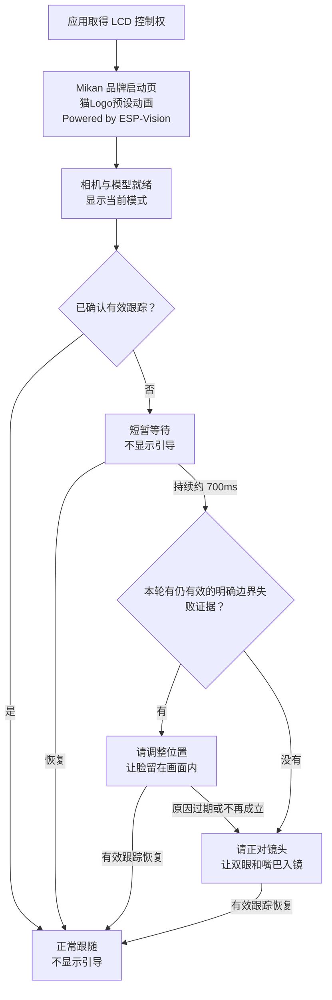

# 启动与取景引导 UI/UX 设计

日期：2026-11-23。状态：用户已确认品牌页、圆润原字标、无启动通知栏，并批准整体放大20%后实施。v78 使用局部眼嘴贴片实现动效，已完成实际相机初始化及启动到运行的UVC交接。模型、嘴眼映射、单骨架和固件沿用v77；完整测量见 [v78实现与验证](v78-startup-and-guidance.md)。

## 目标

让用户在应用启动期间看到明确反馈，并在暂时无法跟随时知道如何调整。使用当前算法真正提供的证据，不将未检出等同“无人”，不将一般 partial 等同“半张脸”或“太近”。正常跟随时保持简洁，嘴眼响应和按键操作保持原有规则。

## 1. 用户流程

v78 实现使用700 ms延后，并在板上状态测试验证。程序基于时间处理提示，不按固定帧数推算，以适应实际帧率。这个提示等待不延迟原算法的跟踪恢复、嘴型更新或保护逻辑。

## 2. 四个界面状态

| 状态 | 用户看到什么 | 主文案 | 辅助文案 |
| --- | --- | --- | --- |
| 启动中 | 黑底，动态猫Logo、Mikan产品名、技术署名作为整体居中 | 无通知栏 | 无通知栏 |
| 正常跟随 | 原有猫头或相机叠加 | 无 | 无 |
| 尚未可靠跟随 | 当前模式内容与清晰的底部引导 | 请正对镜头 | 让双眼和嘴巴入镜 |
| 明确边界失败 | 当前模式内容与琥珀色取景引导 | 请调整位置 | 让脸留在画面内 |

启动页从应用能够操作 LCD 时尽早显示；此前固件启动阶段的黑屏不在本轮应用 UI 的控制范围内。v78 会在相机内存就绪后开始局部动效，至少播放首轮眨眼和张嘴约1.4秒后进入应用；若模型加载更久则循环。这里是明确的品牌展示时间，不显示虚构百分比或进度条。猫Logo播放预设眨眼／张嘴，产品名与技术署名保持静止，启动页不显示通知栏或“正在启动”文字。动效不依赖人脸模型，不用于暗示正在识别人脸。

## 3. 提示的证据契约

v78新增只读用途的失败原因和时间戳，沿用v77接受阈值与跟踪调度；不直接用混合含义的status当物理原因。

### 通用引导

缺少有效跟踪，且本轮没有足够新鲜的明确边界失败证据时，使用“请正对镜头”。可能原因包括未检出、低置信、局部图像质量不足、点位几何不可靠或遮挡。该提示仅提供通用操作，不宣称已经确认物理原因。

### 边界引导

只接受两种可追溯事件：

1. 本次 YuNet 检出了可信的人脸候选，候选框与画面的覆盖检查明确失败。
2. 本次 PFLD 有可用点位，明确因画面边缘位置／安全余量检查失败。

一般几何比例异常、局部眼纹理不足、单眼无效、旧 partial 标签或处于检测冷却时间，不能单独触发边界引导。现代码把口眼比例与边缘判断合在同一分支，实施时必须分开记录实际失败项，不能把整个分支统称边界错误。

原因携带实际观测时间戳，调试输出另记录帧号。只采用本轮失跟会话中的有效原因，检测冷却期间不把缓存框当作新检测。原因的新鲜度为不超过600 ms；过期后回通用引导，不猜测新原因。板上自检覆盖延后、过期、恢复、acquiring和时钟回绕。

### 不在本版显示的分类

“无人”“半张脸”“距离过近”不作为已经确认的产品标签。“请稍微后退”不进入默认文案。脸框越界可能来自靠近、偏移或真实遮切，现有公开近景实验没有建立可靠的近距与偏移分类。

## 4. 两种显示模式

### 居中猫头

保留居中模式。失跟后由原保护逻辑使表情与姿态回中性，避免看起来还在跟随不存在的动作；不要新增自动眨眼、嘴动或呼吸动画。猫头沿用原有 320×320 画布、缩放和位置；提示使用该画布下方原有 LCD 空白，不从猫头区域扣高度，不缩小、不上移猫头，也不自动把用户切去相机模式。

### 相机叠加

保留实时取景画面。按原保护规则停止错误的猫脸叠加，通知栏在与居中模式相同的 LCD 坐标显示相同文案。用户能看到自己的真实位置以自行调整。普通引导页不新增关键点、模型框或调试数字。

可选的静态取景角标只表达推荐摆放区域，不冒充检测框、模型 ROI 或精确接受范围，也不绘制未经验证的左右／前后方向箭头。

### 实体键与关键点页

普通状态短按 AI 仍切换居中／相机叠加，长按仍进入关键点页，短按退出关键点页。引导提示不拦截按键，不要求额外按键确认，不加入校准步骤。关键点页保留原有调试用途；通用大提示不盖住用户正在查看的点位。

## 5. 已选视觉语言与精确排版

用户认可的附件为黑底橘猫、暖深棕底部通知栏、左侧琥珀色竖线、白色主次两行文字。运行中的各类提示统一使用该通知位置；启动页独立为无通知栏的品牌页。之前三方案的重新选择流程结束；精修不再更换视觉语言。

### 实机比例依据

2026-11-23 使用安装插件的被动 screen capture，确认专用 Mosaico、官方 2026.11.14，获得原生 480×480 LCD JPEG。没有停止应用、抓取相机源或更改程序。当前中性猫头可见像素包围框约为 x=109..371、y=97..345，即263×249，分别约占屏幕宽54.8%、高51.9%；下方空白约134px。24/48/64亮度阈值给出同一包围框。这是本帧的实际可见范围，不代表所有表情的最大包络。

现有代码的居中画布为320×320，放在LCD的(80,80)，结束于y=400。因此通知区域应放在其下方，而不是把320画布切出一块或重排猫头。旧生成稿中的比例未严格匹配实机，不作为准确排版依据。后续以实际截图和现有渲染坐标为基准。

### 统一通知栏（480×480 LCD坐标）

| 项目 | 设计值 |
| --- | --- |
| 运行猫头画布 | x80、y80、320×320，原有缩放和位置保持；启动Logo另行设计 |
| 通知栏 | x12、y408、宽456、高64，底部留8px |
| 与猫头画布的间隔 | 8px，不覆盖或压缩320×320画布 |
| 背景 | 实色暖深棕 #231E17，边角不超过4px，无重阴影 |
| 左侧标记 | x24、y420、宽4、高40，琥珀色 #F5AD2A |
| 主文案 | 左起x40，字形顶部约y415，字号28px |
| 辅助文案 | 左起x40，字形顶部约y447，字号18px |
| 两行间距 | 名义字框之间4px；具体字体实际字形范围另核对 |
| 最大行数 | 主文案1行、辅助文案1行；不自动换成第3行 |

主文案长度控制在现有“请正对镜头”“请调整位置”这类短句内。文字过长时先精简文案，不能放大通知高度、缩小猫头或把字体压到难读。字重和实际中文字库需在精确稿里验证，不把AI生成图当字形测量结果。

### 各状态呈现

- 启动：独立的较小动态猫Logo，上方主体为猫Logo与“Mikan”产品名，下方为“Powered by ESP-Vision”技术署名；启动Logo不要求与运行猫头同尺寸。Logo、产品名、技术署名整体水平与垂直居中；启动页不显示“正在启动”通知栏。具体布局与动作见下节。
- 正常：猫头原大小原位置，通知栏全部收起，不常驻品牌水印或状态字。
- 通用失跟：同一通知栏“请正对镜头”／“让双眼和嘴巴入镜”。
- 明确边界失败：同一通知栏“请调整位置”／“让脸留在画面内”。
- 居中与相机模式：按LCD屏幕坐标固定通知栏，不随跟踪框、人脸或素材位置移动；相机模式无效叠加仍按原保护退出。界面状态一致不意味着把两个模式的原画面拉伸成同一比例。

### 通知交互与输出

- 一次整条出现／替换，不逐字打字，不滚动，不叠多条通知，不占据额外猫头区域。
- 重复同一提示不反复“弹出”；恢复有效跟踪后立即收起，不强制读完或停留。
- 正常运行与运行中的失跟通知两种猫头状态，尺寸、锚点完全一致；不以缩放或上移给通知让位。用户已明确：启动页是品牌Logo，与运行猫头的尺寸独立。
- LCD与UVC共享同一条通知状态与素材，并按现有屏幕映射放在对应位置。必须检查UVC缩放后主字可读性，不能只验LCD。
- 使用小区域／复用缓冲合成；不为通知新增完整480×480帧缓冲，不提高模型运行次数。运行通知复用一个456×64 RGB565缓冲（58,368 B），不新增全屏帧。
- 关键点页保留调试内容与原按键规则，不用整脸通知覆盖点位；该页既有调试标题不视为需要迁移的产品通知。

本轮四状态精修生成图（启动／正常／通用失跟／边界失败）仅表达所选通知栏风格。其猫头占屏比例被用户指出不准确，已由本节原生实机截图与坐标约束取代。选中依据和测量记录保存于工程临时目录 `.tmp/memoji-ui-ux-20261123/`；不以生成图重新绘制猫头。

### Mikan 品牌启动页与Logo动作

用户最新确认了启动页与运行页的不同定位：启动猫头是动态Logo，可以更小；运行猫头才需要维持现有实机比例。此前“启动也必须与运行同大小”的约束撤回，仅保留为历史设计记录。上一版原生排版没有Mikan产品名，品牌层级不完整，不再作为启动页目标。

用户最新要求移除启动页通知栏，Logo与文字作为一个品牌组整体居中。下表为已批准紧凑稿的原始尺寸。用户随后要求品牌组围绕屏幕中心(240,240)统一放大20%，正式素材已烘焙此变换，不在板上实时缩放：

| 元素 | 建议布局 |
| --- | --- |
| 动态猫Logo | 独立144×144区域，x168、y121；较前稿略收小，与产品字标组成紧凑整体 |
| 产品名 | 使用用户选定的圆润`Mikan`原字标图，不以系统字体替代；可视框约168×50，x156、y274 |
| 技术署名 | `Powered by ESP-Vision`，居中，y339，13px、次级灰色#a4a4a4 |
| 启动通知栏 | 不显示；屏幕底部留白，不保留通知栏占位 |

字形已由用户附件明确选定。附件是光栅字标，不是可安装字体文件；此前声明使用Nunito等名称但实际系统回落到另一字体，不能称为沿用同一字形。本版直接引用附件原始图像中的Mikan字标，保持宽高比与圆角笔形，裁切视窗仅排除字标以外内容，不重新描字。原始参考拷贝及SHA-256记录在设计预览目录的 `approved-wordmark-reference.png`、`proportioned-preview.json`。正式板上可作为一次预渲染标识素材使用，无需引入整套字体。

内部层级调整为猫Logo约140px可见宽、产品字标约162px可见宽、技术署名约137px宽。猫与名称的视觉间隙约18px，名称与署名的视觉间隙约22px；产品名与猫更紧密，技术署名降低字号和对比度。整体依旧居中，运行猫头和运行通知栏完全不受这套启动比例影响。

2.4秒预设循环的关键帧节奏（设计值）：

| 时间 | 动作 |
| --- | --- |
| 0.00–0.60 s | 中性睁眼、闭嘴，静候 |
| 0.60–0.72 s | 双眼轻闭，形成一次短眨眼 |
| 0.72–1.00 s | 睁眼、闭嘴 |
| 1.00–1.32 s | 轻张嘴，再回闭合；关键帧预览使用中等开口 |
| 1.32–2.40 s | 中性停顿，避免持续挤眉弄眼 |

只动Logo的眼睑和嘴部，不移动Logo，不改变头部轮廓，不加入转头、俯仰或眉毛。产品名和技术署名位置完全静止，启动页无通知栏。v78至少完成首轮约1.4秒动作，不等待完整2.4秒循环；进入运行后立即交回真实表情驱动，失跟仍中性静止，不沿用Logo自驱动画。

本地设计预览在 `.tmp/memoji-startup-brand-20261123/`。最新 `startup-proportioned-motion.gif` 为可播放的关键帧节奏示意（沿用选定字标并收紧内部比例，替代 `startup-centered-motion.gif`；更早的带通知栏版也已撤回），约2.44秒循环；三个设计关键帧由图像生成工具制作，只用于UI评审，不是板上录像，也不是新增的正式角色素材。离屏排版固定480×480，像素比较确认只有(168,121)-(312,265)的Logo区域变化，字标和署名保持不动。中性帧可见品牌组包围框中心为(240,240)，与屏幕中心一致；底部80px为纯黑，无通知栏、占位或状态文字。运行界面实机比例仍以上述LCD原图为依据。

正式实现采用静态品牌底图加四块眼嘴贴片，贴片RGB像素共25,920 B，另需133,152 B紧凑品牌合成底图以满足一次write；UVC预存三张320×240 JPEG，不运行启动推理、实时骨架或JPEG编码。初始静态Logo在模型加载前显示，先释放解压临时图；相机启动后再开启动画线程加载眼模型。退出时等待线程结束，释放图像并再次GC。实机已记录668 ms闭眼、798 ms恢复、1088 ms张嘴、1378 ms恢复；此记录来自板上，不是前述设计GIF。完整启动/运行截图和资源见v78报告。

## 6. 提示切换与恢复

- 失跟时原保护立即生效；提示本身延后出现，减少短暂遮挡、转头或首次确认带来的视觉闪烁。
- 不因短暂 acquiring 额外弹窗，也不要求用户重新配合一轮动作。
- 已有跟踪时只坏一只眼、而嘴与另一侧仍可用，不触发整脸引导。
- 有效跟踪恢复时立即收起提示，不播放淡出动画、不等待文字停留结束，优先恢复有效嘴型的当前帧显示。
- 模式切换保留当前提示状态，但按新模式重新布局。文字变化或提示出现／消失应使居中画面缓存失效，不能被旧猫头缓存覆盖。
- 为减少频繁更换指令，具体边界原因必须来自仍有效的新观测。无法给出可靠原因时始终使用通用引导，不在不同推测之间轮播。

## 7. 确认后的验证清单

| 场景 | 应有的体验 |
| --- | --- |
| 应用初始化 | 先出现Mikan品牌与动态猫Logo，技术署名清晰，品牌组整体居中且无通知栏；完成后自动进入；不依赖人脸推理才亮屏 |
| 空背景、模糊或证据不足 | 持续失跟后显示通用引导，不显示已确认“无人” |
| 已检出但明确越界／安全余量不足 | 有当前原因时显示边界引导；过期原因回到通用引导 |
| 一次短暂失跟 | 原保护有效，提示不闪现 |
| 人脸正常返回 | 跟随恢复，提示立即收起；无需按键或校准 |
| 启动转入运行 | Logo自驱动作停止，运行猫头恢复原实机比例，真实表情接管；失跟时不继续预设眨眼或张嘴 |
| 单眼局部无效但其余仍可靠 | 不因提示逻辑清掉整脸、嘴或另一眼 |
| 切换两模式及关键点页 | 按键原行为保留，无提示残影、错误覆盖或缓存遗漏 |
| 实际 LCD 与 UVC | 主文字可读、无裁字，状态一致；确认启动页和相机背景都真实刷新 |
| 性能与内存 | 不增加模型或检测频率；复核连续内存、嘴眼回归和两模式帧率，结果与设计预算分开报告 |

v78候选使用独立路径 /flash/mikan-v78-ui；原v77路径及模型保留回滚。现有能力与近景证据参见 [当前算法](current-v77.md)、[v77 联合稳定性](v77-joint-stability.md)、[近景与分辨率诊断](v77-near-range-resolution.md)。
