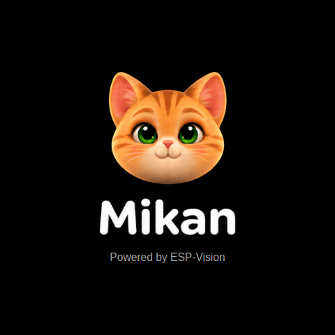

# v78：低资源品牌启动和取景引导

2026-11-23。Mosaico、ESP-VISION 2026.11.14，固件与三个模型权重不变。运行算法、单骨架、嘴部逐帧更新、左右眼独立投票沿用v77；本轮只增加启动和显示引导，并调整大缓冲初始化次序。

## 已批准的视觉

启动页使用用户选定的圆润 **Mikan 原字标**，动态猫Logo、产品名、Powered by ESP-Vision组成居中品牌组，围绕LCD中心统一放大20%。不显示通知栏、启动文字或百分比。启动Logo与运行猫头尺寸独立。

运行保持原320×320猫画布，LCD坐标(80,80)。底部通知位于(12,408,456,64)，主字28px、辅助18px，名义间隔4px，不缩猫头、不挪猫头。关键点页不叠大通知。

## 动画的 trick 与资源

1. 在模型初始化之前先画静态Logo和品牌，分别释放解压临时图；不在初始化峰值持有三张完整Logo。
2. 相机内存就绪后，持有一张228×292紧凑品牌合成图（133,152 B）；线程只改其中双眼和嘴部贴片，再单次写屏。贴片为：两块112×40眼图、两块50×40嘴图，**RGB565像素共25,920 B**。合成底图加贴片共159,072 B；不用实时模型、三维渲染或三份完整Logo动画帧。
3. UVC另存三张预编码320×240 JPEG，**18,368 B**；无需启动全屏RGB缓冲和实时JPEG编码。离线JPEG使用与LCD相同的局部贴片合成源。
4. 中性→短眨眼→张嘴→中性。至少完成约1.4秒首轮动作，随后进入实时页；加载更久则以2.4秒节奏循环。初始静态品牌阶段不声称已经在播放动画。
5. 线程退出握手后释放贴片、JPEG、解压元数据，再GC；正常运行不留动画线程。UVC交接保留主机协商，整个应用退出才reset。

完整资产包 **77,113 B**，含8个RGB565区域和3张JPEG；不是其全部内容同时驻留。运行提示按需复用58,368 B底栏缓冲。当前固件连续write不能保留上次画面，原生双色块探针截图只保留第二块；因此不可分开写猫头和栏。提示出现时复用原320²中心缓冲，按全LCD坐标合成并显示，不另分配480²缓冲。猫头占屏比例不变；此失跟引导页会有一次缩放、稍软，正常无提示仍原320画布1:1，不影响有效跟踪时嘴眼画质。叠加模式的提示页同样合成一次。上述像素字节不包含Image对象、线程栈、文件读解压暂存等开销，不能当总堆占用。

板上实际动作记录：668ms闭眼、798ms睁开、1088ms张嘴、1378ms闭嘴，无线程错误。UVC录像33个解码帧中，10/1/3帧分别与包内中性/眨眼/张嘴JPEG字节一致；另有7帧正常猫头和3帧已人工确认的运行引导画面。其余帧包含应用退出后的原生fallback，不计为正式UI证据。

[UVC三种启动帧与回归证据](../evidence/v78-ui/README.md)

## 提示按实际证据显示

| 当前可观测情况 | 提示 |
| --- | --- |
| 持续未可靠跟踪，原因不明确、低置信或质量失败 | 请正对镜头／让双眼和嘴巴入镜 |
| 本次可信检测框覆盖检查失败，或可用关键点明确越出画面安全边界 | 请调整位置／让脸留在画面内 |
| 跟踪有效、短暂确认中或关键点页 | 无整脸通知 |

失跟提示延后700ms；明确边界证据只用600ms内的观测。一般partial、几何异常、单眼失效、检测冷却缓存不能当作边界原因，也不推断“无人”“半张脸”“太近”。有效跟踪恢复立即清栏；提示变化使居中JPEG缓存失效，LCD/UVC共用状态。

## 同帧板上对照

12份公开RGB565输入，旧版硬复位后跑一段260观察帧；最终新版分成114帧表情/关键点与146帧保护/引导两段，每段前硬复位，共260观察帧，UVC 320×240、10Hz开启。固定输入逐一SHA匹配；没有使用用户照片或个人参数。

| 稳态有效跟踪指标 | v77 | v78 |
| --- | ---: | ---: |
| 居中处理FPS | 6.308 | 6.300 |
| 叠加处理FPS | 3.891 | 3.954 |
| 居中处理耗时中位数 | 124ms | 124ms |
| 叠加处理耗时中位数 | 251ms | 251ms |
| 全260帧最低Python空闲 | 172,896 B | 417,056 B |
| 全260帧最低IDF空闲 | 139,771 B | 238,979 B |
| 全260帧最低IDF最大连续块 | 31,744 B | 100,352 B |
| UVC提交成功 | 258/260 | 260/260 |

处理FPS扣除了离线夹具解码和人为等待，包含相机采样、跟踪、绘制、LCD、JPEG/UVC及调度的眼部推理；重复静态图会使用居中缓存。不是新真人帧率或光学响应延迟验收。帧率差异很小，不宣称显著加速；内存变化同时包含缓冲分配顺序和GC调整，不能全归功于动画。

最终114帧表情/关键点段完整通过：70帧嘴部开度样本、35帧眼部样本、9帧关键点页的状态、表情、原始开度、眼观测和裁框全部一致。双方都为tracking的132帧，表情及测量也全部一致。保护段有13帧状态差异，集中在失跟恢复；检测使用真实时间冷却，显示耗时不同会改变下一次检测时刻，不能宣称全序列逐帧等同。差异保存在[测量JSON](../evidence/v78-ui/paired-summary.json)。本轮没有修复原有近距离或眼模型准确率限制。

板上自检还通过8张RGB素材解码SHA、3张JPEG SHA、提示700ms/600ms/恢复/acquiring/时钟回绕，以及短按/长按的视图切换函数。按键逻辑未改；本轮未让用户重复实体验收。

## 初始化问题与回滚

保留完整启动RGB帧会使相机备用缓冲分配失败；UVC帧源注册在大中心缓冲之前，已连接主机时也会挤占连续内存。改为先显示后释放临时素材、再用紧凑品牌合成与小贴片，且在小对象和UVC注册之前预留中心像素块。首次LCD替换启动画面后GC。完整480²合成虽然能运行，却挤压UVC内存，已撤回，改复用原320²缓冲。最终有界live12测试完成24个真实相机帧和启动到运行交接，无Traceback或UVC内存错误。最终全260连续回归曾被宿主终止于205帧，没有板端Python异常；保留失败日志并改用上述两段完成验证，不声称连续260帧通过。旧版soft reset后回归曾分配失败，硬复位后原文件通过；本次对照双方均记录硬复位条件。

候选入口 `/flash/mikan-v78-ui/start.py`，五个新文件独立放置，模型和四个公共模块沿用旧路径。全部15个依赖大小与SHA已与设备核对，[清单](../runtime/v78/runtime-manifest.json)。原 `/flash/mikan-v60` 未覆盖，可按原v77入口回滚。

当前是显式启动Mikan应用的品牌页。设备原 `/flash/main.py` 为无关相机示例，按工程约定未替换；尚未将Mikan设置为断电重启自动入口，不能把应用启动验证描述为整机自动启动已配置。固件自身在应用控制LCD之前的画面不属于本轮。
